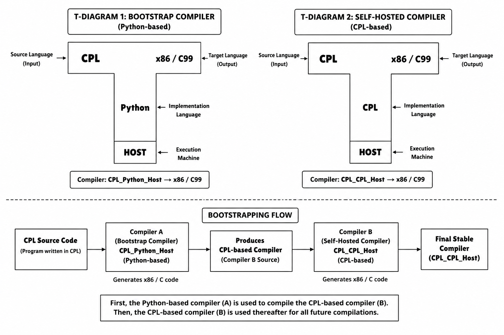
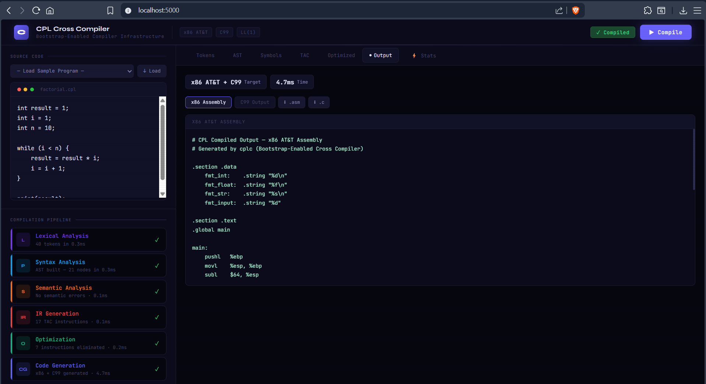
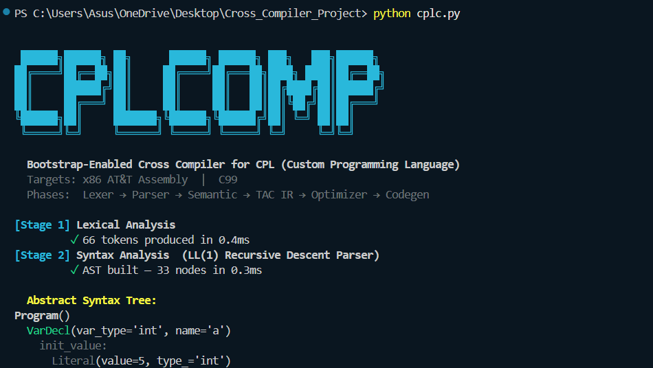
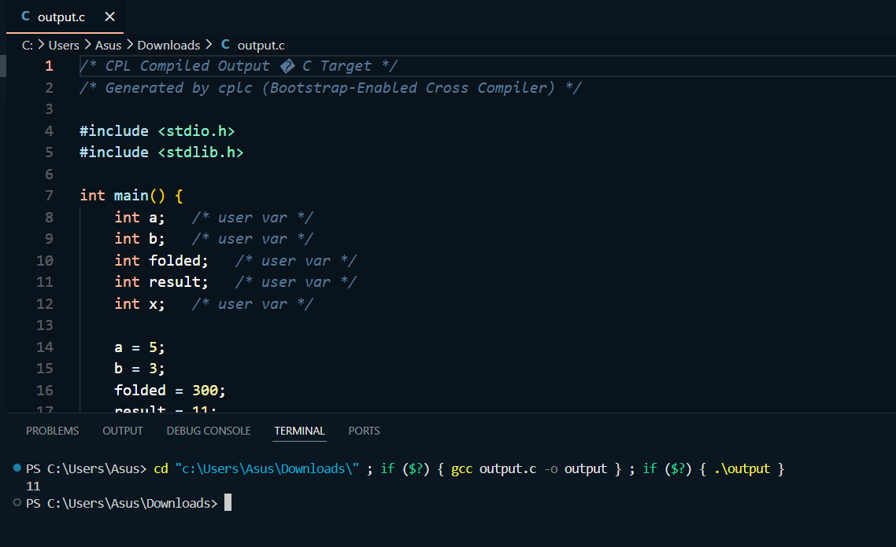
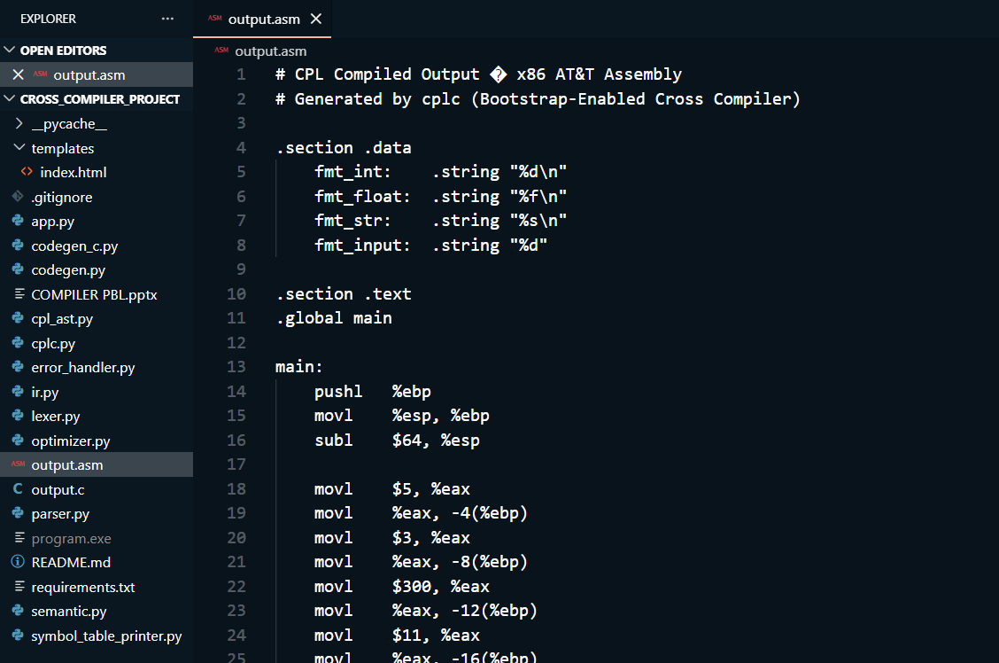
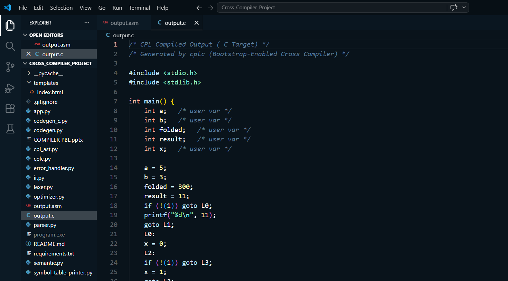

<div align="center">

              ```
              ██████╗██████╗ ██╗            ██████╗ ██████╗ ███╗   ███╗██████╗ ██╗██╗     ███████╗██████╗
              ██╔════╝██╔══██╗██║           ██╔════╝██╔═══██╗████╗ ████║██╔══██╗██║██║     ██╔════╝██╔══██╗
              ██║     ██████╔╝██║           ██║     ██║   ██║██╔████╔██║██████╔╝██║██║     █████╗  ██████╔╝
              ██║     ██╔═══╝ ██║           ██║     ██║   ██║██║╚██╔╝██║██╔═══╝ ██║██║     ██╔══╝  ██╔══██╗
              ╚██████╗██║     ███████╗      ╚██████╗╚██████╔╝██║ ╚═╝ ██║██║     ██║███████╗███████╗██║  ██║
              ╚═════╝╚═╝     ╚══════╝       ╚═════╝ ╚═════╝ ╚═╝     ╚═╝╚═╝     ╚═╝╚══════╝╚══════╝╚═╝  ╚═╝
              ```
# CPL Cross Compiler

### A full-pipeline compiler for the CPL language — from source to x86 Assembly & C99


</div>

## Quick Links

- [What is CPL Compiler?](#what-is-cpl)
- [Setup](#setup)
- [T Diagram](#compiler-bootstrapping-process-diagram)
- [How to use](#how-to-use)
- [Where cross-compilation](#where-cross-compilation)
- [Screenshots](#screenshots-of-projects)
- [app.py](app.py)
- [cplc.py](cplc.py)

<a id="what-is-cpl"></a>
## ✨ What is CPL Compiler?(CPL=Custom Programming Lang.)

**CPL Compiler** is a **6-stage cross compiler** built with Python and Flask. It takes CPL source code and walks it through the complete compilation pipeline — right in your browser.
It generates both **x86-style Assembly and C99** from the same source.

### 🔁 Compilation Pipeline

```
                                Source Code
                                   │
                                   ▼
                            ┌──────────────┐
                            │  1. Lexer    │  → Tokenizes source into typed tokens
                            └──────┬───────┘
                                   ▼
                            ┌──────────────┐
                            │  2. Parser   │  → Builds Abstract Syntax Tree (AST)
                            └──────┬───────┘
                                   ▼
                            ┌──────────────┐
                            │  3. Semantic │  → Type checking, scope & symbol resolution
                            └──────┬───────┘
                                   ▼
                            ┌──────────────┐
                            │  4. IR Gen   │  → Generates Three-Address Code (TAC)
                            └──────┬───────┘
                                   ▼
                            ┌──────────────┐
                            │  5. Optimizer│  → Dead code elimination & instruction reduction
                            └──────┬───────┘
                                   ▼
                            ┌──────────────┐
                            │  6. Codegen  │  → Outputs x86 Assembly + C99 code
                            └──────────────┘
```


## Setup

### Requirements:

- Python 3.8+               (Verify: `python --version`)

### Install and run (choose one mode after install):

```bash
git clone https://github.com/vikasjha11/Cross_Compiler_Project.git
cd Cross_Compiler_Project 
pip install -r requirements.txt
```

## Run the complete compiler (two ways)

Path A - Web UI (recommended for full visual pipeline):

```bash
python app.py
```

Open in browser:

```text
http://localhost:5000
```

Then:

1. Paste CPL code in the editor.
2. Click Compile.
3. Verify all pipeline stages appear: Tokens, AST, Semantic, TAC, Optimized TAC, Assembly, C output.
4. Check generated files in project root: output.asm and output.c.

Path B - CLI mode (recommended for terminal demo):

```bash
python cplc.py
```

Then:

1. Watch all 6 stages print in terminal.
2. Verify final files generated in project root: output.asm and output.c.
3. Use these outputs for verification on another machine.

## Compiler bootstrapping process diagram

The project also follows the idea of a T-diagram, where the compiler is shown as a translation tool from CPL source into target code.




In this project:

1. The host machine runs the compiler.
2. The compiler translates CPL into x86 Assembly and C99.
3. The generated C file can be moved to another machine and compiled there.
4. This shows the cross-compilation pipeline clearly in T-diagram form.

## Bootstrapping workflow

### What is bootstrapping?

Bootstrapping a compiler means using a simpler version of the compiler (or a host compiler) to compile a more advanced version of itself. This is a classic technique in compiler development that demonstrates the compiler can compile its own kind of code.

### Bootstrap phases in this project

**Phase 0 — Host compilation:**
1. Run the Python-based CPL compiler on `bootstrap.cpl`.
2. The compiler outputs `output.asm` (x86 assembly) and `output.c` (C99 source).
3. Inspect the generated code to confirm it correctly represents the bootstrap seed logic.

**Phase 1 — Native compilation:**
1. Compile the generated `output.c` with your system C compiler (gcc or clang).
2. This creates a native binary that can run independently.
3. The C output is portable and can be moved to another machine.

**Phase 2 — Self-hosting iteration:**
1. Use the native compiler from Phase 1 to compile future CPL programs.
2. Eventually, compile a CPL-written version of the compiler itself.
3. Once the CPL compiler can compile itself, the project is fully self-hosted.

### How to run the bootstrap workflow

**Option A: Bootstrap mode (recommended for demo)**

```bash
python cplc.py --bootstrap
```

This runs Phase 0 automatically on `bootstrap.cpl`, shows all compilation stages, and prints the bootstrap narrative.

**Option B: Compile any CPL file directly**

```bash
python cplc.py bootstrap.cpl --target both
```

This also generates both target outputs but without the bootstrap narrative.

## How to use

### Web UI

1. Paste CPL code in the editor.
2. Click Compile.
3. Check all stage outputs in the right panel.

Each compile also overwrites:

- `output.asm`
- `output.c`

### CLI mode

```bash
python cplc.py
```

CLI prints all compilation stages and writes `output.asm` and `output.c`.

## Where cross-compilation

See both points:

1. Your compiler generates target files (`output.asm`, `output.c`) from CPL source.
2. Generated target code runs on another machine.

Demo steps:

1. Run compiler on your machine (`python cplc.py` or web compile).
2. Show generated files in project root.
3. Copy `output.c` to another machine.
4. Compile and run on the other machine:

```bash
gcc output.c -o program
./program
```

5. Show matching output.

Notes:

- `output.c` is the portable proof (works across CPU architectures when recompiled).
- `output.asm` is architecture-specific (x86).

## Screenshots of Projects

### Web Ui



### CLI Mode



### Cross-machine proof steps



### Generated x86 Assembly output



### Generated C99 output




